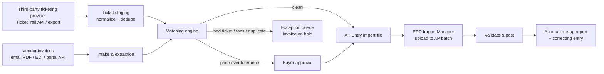

# Case study: automating incoming-material AP at Copperhollow Materials Co.

> **Everything in this case study is fictional.** Copperhollow Materials Co., its vendors, people, ticket numbers, GL accounts and dollar amounts were invented for this portfolio. The process is modeled on common practice at asphalt and aggregates producers that run a construction ERP (Vista by Viewpoint–style), not on any real company's data.
>
> Items marked **[GUESS]** are placeholders I still need to confirm or adjust before this goes public.

## The company

**Copperhollow Materials Co.** runs two hot-mix asphalt plants and a small aggregate yard in a fictional three-county region. It sells mix to its sister company, **Copperhollow Paving & Grading**, and to outside contractors. About **25 vendor invoices and 400 scale tickets a month** cover incoming rock, sand, liquid asphalt binder and the trucking that brings them in. **[GUESS: volumes]**

| Role | Fictional vendor | Vendor # | Billing |
|---|---|---|---|
| Rock supplier | Granite Bend Quarry | 41020 | Weekly, per ticket |
| Rock supplier | Blue Mesa Aggregates | 41035 | Weekly, per ticket |
| Hauler | Redline Hauling LLC | 41210 | Weekly, per ticket, $/ton |
| Hauler | Two Rivers Trucking | 41225 | Weekly, per ticket, $/ton |
| Binder supplier | Cascade Bitumen Supply | 41300 | Weekly, per load |

## The problem (before)

1. **Accrue at the scale.** Each inbound truck is weighed, and the ticket is captured by a **third-party e-ticketing provider** (fictional: *TicketTrail*). Its tickets accrue material and hauling to the **AP Accrued – Incoming Material** clearing account (fictional GL `2015.`) at the *system* price.
2. **Invoices arrive by email as PDFs**, one per vendor per week, listing every ticket.
3. **An AP clerk keys each invoice** into ERP AP Entry and checks the tickets against a scale report in a spreadsheet, line by line.
4. **Price changes go unnoticed.** When a supplier raises prices, invoices run above the accrual, and the difference piles up in the clearing account until month-end.
5. **Month-end cleanup.** Accounting reconciles the clearing account by hand, explains the leftover balance and books a correcting entry to inventory.

Pain points: hours of keying every week, duplicate-ticket billing caught late or not at all, and a clearing-account balance nobody could explain without a day of spreadsheet work. **[GUESS: replace with your real before-state metrics, e.g. hours/week]**

## The solution (after)

1. **Third-party ticket feed.** Material tickets come from an outside e-ticketing provider, not from our own system. The integration pulls them from the provider's API (or a scheduled export file), maps the provider's material and vendor codes to ours, drops voided tickets, and lands them in a staging table. **[GUESS: pull frequency and whether it's API or file]**
2. **Invoice intake.** Invoices come in through a shared mailbox (PDF extraction), a vendor CSV, or a vendor portal API, and all are normalized to one invoice-line layout.
3. **Matching engine.** Every invoice line is matched to its scale ticket on ticket number, then tons (±0.05 t) and unit price (±2%).
   - **Matched** lines are ready to import.
   - **Price variance** lines go to the buyer to approve, and the variance is reported by category.
   - **Hard exceptions** (unknown ticket, tonnage mismatch, ticket already billed) put the whole invoice on hold with a reason.
4. **Import, not keying.** Approved invoices are written to an AP Entry import file (header + line records), uploaded through the ERP Import Manager into an AP batch, validated, and posted.
5. **Built-in tie-outs.** The run stops unless import lines equal headers, headers equal approved invoice totals, and every invoice is either imported or held.
6. **Month-end true-up.** The clearing-account balance is explained automatically: what was accrued, what was cleared, what is still open, and the price variance by category, plus the correcting entry (Dr Inventory / Cr AP Accrued).

## Results on the sample month (October 2026, fake data)

Produced by [`scripts/ap_pipeline.py`](scripts/ap_pipeline.py); see [`output/run_summary_oct2026.json`](output/run_summary_oct2026.json).

| Measure | Value |
|---|---|
| Scale tickets accrued | 389 tickets, $1,485,648.22 |
| Vendor invoices received | 25 |
| Imported automatically | 17 |
| Imported after price approval | 5 |
| Held for exceptions | 3 |
| Imported to AP | $1,465,778.12 |
| Price variance surfaced (Blue Mesa +7%) | $3,605.04 |
| Accrual still open, explained | $23,475.14 |
| Tie-out checks | 3 of 3 pass |

The three held invoices show what the engine catches: a ticket number that does not exist, 3 extra tons billed on one ticket, and the same ticket billed twice.

**[GUESS: add your real "after" numbers, e.g. keying time cut from X hours to Y minutes, close shortened by N days]**

## What's in this folder

| Path | What it is |
|---|---|
| `data/` | Fake inputs: vendor master, scale tickets, invoice headers and lines |
| `output/AP_Entry_Import_Oct2026.csv` | The generated AP import file (no header row, CRLF) |
| `output/exception_queue_oct2026.csv` | Every line not cleanly matched, with a reason |
| `output/run_summary_oct2026.json` | Run totals and tie-out results |
| [`docs/import-layouts.md`](docs/import-layouts.md) | File layouts and import template settings |
| [`docs/api-integration.md`](docs/api-integration.md) | API integration flow into the ERP |
| `scripts/ap_pipeline.py` | The whole pipeline in about 250 lines of Python, standard library only |
| `scripts/mock_servers.py` | Mock ticketing-provider API and mock ERP AP API (batches, invoices, validate, post, role checks) |
| `scripts/api_demo.py` | The integration service: pulls tickets, maps codes, matches, sends invoices to the ERP API, logs every call |
| `scripts/build_replay.py` + `site/` | Builds the replay page (ERP back-end setup + call-by-call replay) from the run log |
| `output/api_run_log.json` | Every request and response from the API run |

## Seeing the API hit the ERP

`python scripts/api_demo.py` starts two mock servers and runs the overnight integration against them: OAuth to the ticketing provider, 4 pages of tickets (one void and one unknown carrier held), matching, OAuth to the ERP, open an AP batch, 22 invoices added, a simulated timeout retry refused as a duplicate (409), validate, the integration user blocked from posting (403), and an AP supervisor posting the batch. The run ends with a tie-out of the ERP batch against the approved total. Then `python scripts/build_replay.py` turns the log into `site/index.html`, which shows the ERP back-end setup and replays the run call by call.

Run it yourself: `python scripts/ap_pipeline.py`. The data is seeded, so you get the same numbers every time.
