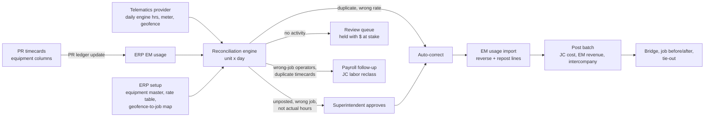

# Case study: reconciling equipment usage to telematics at Copperhollow

> **Everything in this case study is fictional.** Copperhollow Materials Co., Copperhollow Paving & Grading, their jobs, equipment, people, GL accounts and dollar amounts were invented for this portfolio. The process is modeled on common practice at paving contractors that run a construction ERP (Vista by Viewpoint–style) with an equipment (EM) module, not on any real company's data.
>
> Items marked **[GUESS]** are placeholders I still need to confirm or adjust.

**Live demo:** [equipment usage reconciliation, day by day](https://reneec1988.github.io/Renee-C/equipment-usage-recon/site/)

## The company

Two related companies share one fleet:

| Company | ERP Co | Owns | Role in this process |
|---|---|---|---|
| Copperhollow Materials Co. | 1 | Asphalt plants, aggregate yard, 2 wheel loaders; plant job 26-9010 | Loans its loaders to paving jobs; borrows paving trucks and skid steers for stockpile work |
| Copperhollow Paving & Grading | 2 | 30 units: pavers, rollers, milling machines, tack trucks, skid steers, excavators, dump trucks; jobs 26-1104 to 26-1131 | Runs the paving jobs; owns most of the fleet |

Equipment moves between the two companies in both directions, so usage creates **intercompany** charges each way.

**Usage is posted with payroll.** Foremen enter each machine and its hours in the equipment columns of the crew timecard, and the payroll ledger update posts the hours to EM usage: equipment cost on the job, and equipment revenue for the company that owns the machine. Usage is billed at **hourly rates by category** on the **actual hours the machine was used**. 29 of the 32 units have a **telematics device** that reports daily engine hours, the hour meter, and which job-site geofence the machine worked in. **[GUESS: fleet size, rates and telematics coverage]**

## Why it matters

Equipment usage is one of the largest costs on a paving job, and it's the one with the least checking. When it's wrong:

- **Job margins are wrong.** A milling machine left off a timecard for three days makes a job look $10,000 more profitable than it is. Over/under billings and the WIP schedule inherit the error.
- **Equipment revenue is wrong,** so the equipment cost pool doesn't recover its ownership and operating costs, and rate-setting next year starts from bad numbers.
- **Intercompany drifts.** When the materials company's loaders work paving jobs, each missed hour leaves the due-to/due-from out of balance between the two companies.

## The problem (before)

1. **Usage comes in through payroll.** Foremen add equipment and hours to the daily crew timecard, and the payroll ledger update posts the usage to EM and JC.
2. **Nobody compares it to what the machines did.** Telematics data sits in the equipment manager's portal, not in accounting.
3. **Common errors slip through:** the operator is on the timecard but the equipment column is blank, the operator's shift hours are keyed as machine hours, a machine is charged to the crew's job instead of the job it was working (sometimes the other company's job), lines are keyed twice, timecards are copied forward on days the unit sat in the yard, and old rates stay on a timecard after the rate table changes.
4. **Month-end is a spot check at best.** Project managers catch some of it at cost review, weeks later, and the fix is a manual entry nobody can trace back to a machine and a day.

**[GUESS: replace with your real before-state, e.g. hours spent and how often errors surfaced late]**

## The solution (after)

1. **Start from payroll.** Every usage line is tied back to its timecard line, and the run first proves that timecard equipment hours and dollars equal the EM usage the payroll update posted.
2. **One row per machine per day.** Telematics gives engine hours and the primary geofence; each geofence maps to a job and its company (the yard maps to none). Posted usage is grouped the same way.
3. **Every unit-day is classified exactly once:**

| Finding | Test | What happens |
|---|---|---|
| Matched | Same job, hours within ±1.0 hr of engine hours, current rate | Nothing |
| Duplicate | Same unit, day, job, hours and rate posted twice | **Auto:** reverse the extra line |
| Wrong rate | Posted rate ≠ rate table on the actual date | **Auto:** reverse, repost at the current rate |
| Not posted | ≥1.0 engine hr inside a job geofence, operator on the timecard, equipment column blank | **Approve, then post** actual hours (engine hours rounded to 0.5) to that job |
| Not actual hours | Posted vs engine hours differ by more than 1.0 hr (shift hours keyed as machine hours) | **Approve, then** reverse and repost at actual hours |
| Wrong job | Posted job ≠ the job whose geofence the unit was in | **Approve, then** reverse from the posted job, repost to the right one; operator labor goes on the payroll reclass list |
| No activity | Usage posted, unit never left the yard | **Hold:** likely a copied timecard, or a dead device |
| No telematics | Unit has no device | Passes on the timecard; listed for a spot check |

4. **Corrections post as usage, not as a journal entry.** Each fix is a reversing line plus a reposting line in an EM usage batch, so job cost, equipment revenue, hour meters and intercompany all update through the ERP's own posting, and every dollar traces to a unit, a day and a finding.
5. **Payroll follow-up.** Operators on wrong-job days are listed for a JC labor reclass (no paycheck change; cross-company lines flagged), and duplicated timecards are flagged so payroll can check the labor hours.
6. **Built-in tie-outs.** The run stops unless payroll equals EM usage, every posted line and every telematics day is classified once, the import total equals the approved corrections, posted plus corrections equals corrected usage by job, the GL effect balances, and intercompany due-to equals due-from in both directions.

## Results on the sample month (October 2026, fake data)

Produced by [`scripts/em_usage_recon.py`](scripts/em_usage_recon.py); see [`output/recon_summary_oct2026.json`](output/recon_summary_oct2026.json).

| Measure | Value |
|---|---|
| Fleet / with telematics | 32 units / 29 |
| Payroll timecard lines | 492 (480 with equipment, 12 with the equipment column blank) |
| Usage posted by payroll | 480 lines, $408,962.50 (ties to timecards) |
| Telematics unit-days checked | 638 |
| Matched clean | 409 lines |
| Auto-corrected (11 wrong-rate, 3 duplicates) | 14 findings, −$1,608.50 |
| Corrected after approval (12 not posted, 5 not actual hours, 8 wrong job) | 25 findings, +$13,820.00 |
| Cost moved to the right job (wrong job) | $6,114.00 |
| Held for review (days in the yard) | 3 findings, −$1,776.00 at stake, not booked |
| Correction batch | 63 usage lines, net +$12,211.50 |
| Intercompany corrections | $1,377.50 materials loaders on paving jobs; $2,175.00 paving units at the plant |
| Operator labor for payroll to reclass | 8 lines, 72.5 hrs (2 cross-company) |
| Tie-out checks | 7 of 7 pass |

The biggest single catch: a **cold planer ran three days on Riverside Commons while its operator's timecards had the equipment column blank**, $10,660 of job cost and equipment revenue that would have been missed.

**[GUESS: add your real "after" numbers, e.g. usage errors caught per month, hours of review saved, close days]**

## GL effect of the correction batch

| Co | Account | Description | Debit | Credit |
|---|---|---|---:|---:|
| 2 | 1450. | Due from Copperhollow Materials | 2,175.00 | |
| 2 | 2450. | Due to Copperhollow Materials | | 1,377.50 |
| 2 | 4610. | Equipment Revenue – Internal | | 7,946.50 |
| 2 | 4615. | Equipment Revenue – Intercompany | | 2,175.00 |
| 2 | 5410. | Job Cost – Equipment | 9,324.00 | |
| 1 | 1450. | Due from Copperhollow Paving | 1,377.50 | |
| 1 | 2450. | Due to Copperhollow Paving | | 2,175.00 |
| 1 | 4610. | Equipment Revenue – Internal | | 712.50 |
| 1 | 4615. | Equipment Revenue – Intercompany | | 1,377.50 |
| 1 | 5410. | Job Cost – Equipment | 2,887.50 | |
| | | **Total** | **15,764.00** | **15,764.00** |

Each company's due-from equals the other company's due-to. Internal equipment revenue and job cost eliminate on consolidation; the reconciliation's value is that each job carries the right cost and each company the right revenue.

## What's in this folder

| Path | What it is |
|---|---|
| `data/` | Fake inputs: equipment master, revenue rates, jobs and geofences, payroll timecards, daily telematics, posted EM usage |
| `output/EM_Usage_Import_Oct2026.csv` | The correction batch: reversing and reposting usage lines, by owning company |
| `output/findings_oct2026.csv` | Every finding with its action and net amount |
| `output/review_queue_oct2026.csv` | Held items for the superintendent, with dollars at stake |
| `output/labor_reclass_for_payroll_oct2026.csv` | Operator labor hours payroll charged to the wrong job |
| `output/recon_summary_oct2026.json` | Bridge, job before/after, GL effect and tie-out results |
| [`docs/import-layouts.md`](docs/import-layouts.md) | File layouts and the EM usage import template |
| [`docs/path-to-production.md`](docs/path-to-production.md) | How this runs against Vista, NetSuite and Deltek, and the rollout plan |
| `scripts/em_usage_recon.py` | The whole reconciliation in Python, standard library only |
| `scripts/build_site.py` + `site/` | Builds the interactive page from the run |

Run it yourself: `python scripts/em_usage_recon.py`, then `python scripts/build_site.py`. The data is seeded, so you get the same numbers every time.
