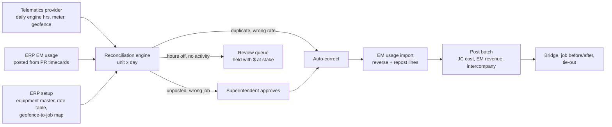

# Case study: reconciling equipment usage to telematics at Copperhollow

> **Everything in this case study is fictional.** Copperhollow Materials Co., Copperhollow Paving & Grading, their jobs, equipment, people, GL accounts and dollar amounts were invented for this portfolio. The process is modeled on common practice at paving contractors that run a construction ERP (Vista by Viewpoint–style) with an equipment (EM) module, not on any real company's data.
>
> Items marked **[GUESS]** are placeholders I still need to confirm or adjust.

**Live demo:** [equipment usage reconciliation, day by day](https://reneec1988.github.io/Renee-C/equipment-usage-recon/site/)

## The company

Two related companies share one fleet:

| Company | ERP Co | Owns | Role in this process |
|---|---|---|---|
| Copperhollow Materials Co. | 1 | Asphalt plants, aggregate yard, 2 wheel loaders | Loans its loaders to paving jobs and earns intercompany equipment revenue |
| Copperhollow Paving & Grading | 2 | 30 units: pavers, rollers, milling machines, tack trucks, skid steers, excavators, dump trucks | Runs the jobs; owns most of the fleet |

Equipment is charged to jobs at **internal hourly rates by category** (revenue code 1, hourly operating). Every hour posted debits the job's equipment cost and credits equipment revenue for the company that owns the machine. 29 of the 32 units have a **telematics device** that reports daily engine hours, the hour meter, and which job-site geofence the machine worked in. **[GUESS: fleet size, rates and telematics coverage]**

## Why it matters

Equipment usage is one of the largest costs on a paving job, and it's the one with the least checking. When it's wrong:

- **Job margins are wrong.** A milling machine left off a timecard for three days makes a job look $10,000 more profitable than it is. Over/under billings and the WIP schedule inherit the error.
- **Equipment revenue is wrong,** so the equipment cost pool doesn't recover its ownership and operating costs, and rate-setting next year starts from bad numbers.
- **Intercompany drifts.** When the materials company's loaders work paving jobs, each missed hour leaves the due-to/due-from out of balance between the two companies.

## The problem (before)

1. **Usage comes from crew timecards.** Foremen add equipment and hours to the daily timecard, and payroll processing posts the usage to jobs.
2. **Nobody compares it to what the machines did.** Telematics data sits in the equipment manager's portal, not in accounting.
3. **Common errors slip through:** machines left off the timecard, a machine charged to the crew's job instead of the job it was working, lines keyed twice, timecards copied forward on days the unit sat in the yard, and old rates still on a timecard after the rate table changed.
4. **Month-end is a spot check at best.** Project managers catch some of it at cost review, weeks later, and the fix is a manual entry nobody can trace back to a machine and a day.

**[GUESS: replace with your real before-state, e.g. hours spent and how often errors surfaced late]**

## The solution (after)

1. **One row per machine per day.** Telematics gives engine hours and the primary geofence; each geofence maps to a job (the yard and plant map to none). Posted usage is grouped the same way.
2. **Every unit-day is classified exactly once:**

| Finding | Test | What happens |
|---|---|---|
| Matched | Same job, hours within ±1.0 hr of engine hours, current rate | Nothing |
| Duplicate | Same unit, day, job, hours and rate posted twice | **Auto:** reverse the extra line |
| Wrong rate | Posted rate ≠ rate table on the actual date | **Auto:** reverse, repost at the current rate |
| Not posted | ≥1.0 engine hr inside a job geofence, nothing posted | **Approve, then post** engine hours (rounded to 0.5) to that job |
| Wrong job | Posted job ≠ the job whose geofence the unit was in | **Approve, then** reverse from the posted job, repost to the right one |
| Hours off | Posted vs engine hours differ by more than 1.0 hr | **Hold:** could be standby or a shared operator; the superintendent decides |
| No activity | Usage posted, unit never left the yard | **Hold:** likely a copied timecard |
| No telematics | Unit has no device | Passes on the timecard; listed for a spot check |

3. **Corrections post as usage, not as a journal entry.** Each fix is a reversing line plus a reposting line in an EM usage batch, so job cost, equipment revenue, hour meters and intercompany all update through the ERP's own posting, and every dollar traces to a unit, a day and a finding.
4. **Built-in tie-outs.** The run stops unless every posted line and every telematics day is classified once, the import total equals the approved corrections, posted plus corrections equals corrected usage by job, the GL effect balances, and intercompany due-to equals due-from.

## Results on the sample month (October 2026, fake data)

Produced by [`scripts/em_usage_recon.py`](scripts/em_usage_recon.py); see [`output/recon_summary_oct2026.json`](output/recon_summary_oct2026.json).

| Measure | Value |
|---|---|
| Fleet / with telematics | 32 units / 29 |
| Telematics unit-days checked | 638 |
| Usage lines posted from timecards | 458 lines, $395,563.50 |
| Matched clean | 406 lines |
| Auto-corrected (11 wrong-rate, 3 duplicates) | 14 findings, −$1,728.50 |
| Corrected after approval (8 unposted, 6 wrong job) | 14 findings, +$13,301.50 |
| Cost moved to the right job (wrong job) | $4,537.00 |
| Held for review (5 hours variances, 3 yard days) | 8 findings, −$3,345.00 at stake, not booked |
| Correction batch | 45 usage lines, net +$11,573.00 |
| Intercompany (materials company loader) | $522.50 due to / due from, offsetting |
| Tie-out checks | 6 of 6 pass |

The biggest single catch: a **cold planer ran three days on Riverside Commons with nothing on the timecards**, $10,660 of job cost and equipment revenue that would have been missed.

**[GUESS: add your real "after" numbers, e.g. usage errors caught per month, hours of review saved, close days]**

## GL effect of the correction batch

| Co | Account | Description | Debit | Credit |
|---|---|---|---:|---:|
| 2 | 5410. | Job Cost – Equipment | 11,573.00 | |
| 2 | 4610. | Equipment Revenue – Internal | | 11,050.50 |
| 2 | 2450. | Due to Copperhollow Materials Co. | | 522.50 |
| 1 | 1450. | Due from Copperhollow Paving & Grading | 522.50 | |
| 1 | 4615. | Equipment Revenue – Intercompany | | 522.50 |

Internal equipment revenue and job cost eliminate on consolidation; the reconciliation's value is that each job carries the right cost and each company the right revenue.

## What's in this folder

| Path | What it is |
|---|---|
| `data/` | Fake inputs: equipment master, revenue rates, jobs and geofences, daily telematics, posted EM usage |
| `output/EM_Usage_Import_Oct2026.csv` | The correction batch: reversing and reposting usage lines, by owning company |
| `output/findings_oct2026.csv` | Every finding with its action and net amount |
| `output/review_queue_oct2026.csv` | Held items for the superintendent, with dollars at stake |
| `output/recon_summary_oct2026.json` | Bridge, job before/after, GL effect and tie-out results |
| [`docs/import-layouts.md`](docs/import-layouts.md) | File layouts and the EM usage import template |
| [`docs/path-to-production.md`](docs/path-to-production.md) | How this runs against Vista, NetSuite and Deltek, and the rollout plan |
| `scripts/em_usage_recon.py` | The whole reconciliation in Python, standard library only |
| `scripts/build_site.py` + `site/` | Builds the interactive page from the run |

Run it yourself: `python scripts/em_usage_recon.py`, then `python scripts/build_site.py`. The data is seeded, so you get the same numbers every time.
